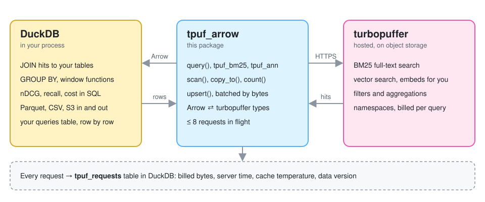
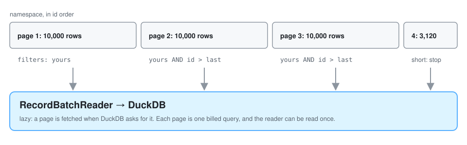
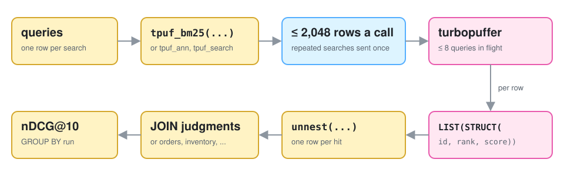

# How tpuf-arrow works

Written against DuckDB 2.0.0, pyarrow 26, and version 2.14 of turbopuffer's Python SDK.



The package has three main modules:

- `client.py` makes every request to turbopuffer. It converts responses to Arrow, logs one row per request, and holds the semaphore that limits how many requests are in flight.
- `sql.py` registers the DuckDB functions. The only thing it calls is `Client.query`.
- `types.py` maps types in both directions. It does no I/O.

## Why Arrow instead of a table function

The obvious design is a DuckDB table function, `SELECT * FROM tpuf_scan('products')`, that sees the query's filters and columns and passes them on to turbopuffer. DuckDB's Python API can't define one. In 2.0.0, `create_function` only makes scalar functions, and `table_function` only calls functions DuckDB already has.

What Python can do is hand DuckDB an Arrow object. DuckDB will query a local Arrow variable by name, and `con.register` gives one a name explicitly. So reads come back as Arrow, and the filters and columns a table function would have received become ordinary arguments to `scan` and `query`.

You notice this in two places. There's no implicit pushdown: a `WHERE` on a registered reader filters after every page has arrived. And a `RecordBatchReader` can only be read once. If you query it twice, DuckDB 2.0 tells you so ("This RecordBatchReader has already been consumed"). `copy_to` covers the common case of wanting the rows in a real table.

## Reading

**Ranked queries.** `Client.query` sends one query and returns an Arrow table: `id`, `rank`, `score` (turbopuffer's `$dist`), then the requested attributes. Column types come from the namespace schema, fetched once per namespace and cached, so an empty result has the same schema as a full one and results from different queries stack cleanly.

**Scans.** turbopuffer has no export endpoint. Its [export guide](https://turbopuffer.com/docs/export) pages through a namespace in id order, filtering on `id > last_id`, 10,000 rows a page. `Client.scan` does the same thing lazily inside a `RecordBatchReader`, so a page is fetched when DuckDB asks for it. Your filters are ANDed with the cursor:



Each page is a billed query. Pages have to be fetched in order, since each one needs the last id of the one before it, so a scan is serial.

**Counts.** `Client.count` sends `aggregate_by {"n": ["Count"]}` instead of scanning. turbopuffer's docs advise against aggregations on latency-sensitive paths for namespaces over 1M documents.

**Search per row.** `tpuf_search` is a scalar UDF registered with `type=ARROW` and `side_effects=True`. Without that flag, DuckDB treats the function as pure and may cache or reorder calls. `tpuf_bm25` and `tpuf_ann` are SQL macros that build the `rank_by` JSON with `json_array` and call it.



DuckDB passes the UDF a batch of up to 2,048 rows. The UDF skips rows where the namespace, rank_by, or top_k is NULL, collapses identical searches, runs the rest on a thread pool, and returns a list of hits per row. 5,000 rows arrive in three calls: 2,048, 2,048, and 904.

## Writing

`Client.upsert` takes anything with `__arrow_c_stream__`, so a DuckDB relation streams in without the whole result being materialized first. The incoming batches are regrouped into requests of about `batch_bytes` (4 MB by default). Size is estimated from the JSON of a sample of rows, because that's what turbopuffer receives and bills, and it runs several times bigger than the Arrow size. A float32 is 4 bytes in Arrow and about 20 as JSON text, since `0.123456` goes out as `0.12345600128173828`. turbopuffer's batch discount applies per request and reaches 50% at about 3.2 MB, and sizing by rows would leave most requests short of that. Small batches are merged. If any attribute is embedded by turbopuffer, requests are capped at 256 rows, turbopuffer's limit for those writes.

Up to `workers` requests (4 by default) run at once, and up to as many again wait in the pool. A 4xx response other than 429 stops new requests, since the next batch would almost certainly fail the same way. Once the in-flight requests finish, `upsert` raises `UpsertError` with what succeeded and one line per failure. The reader is closed either way, because a DuckDB connection won't run anything else while a result stream is open.

**Types on the way in.** Unless a write says otherwise, turbopuffer infers an attribute's type from the first values it sees, and the type can't change later. I hit this on the first live run: a DOUBLE column holding `1.5, 2.0` got a 400 because turbopuffer had already typed the attribute as `int`. So `upsert` sends an explicit type, based on the Arrow type, for every attribute the namespace doesn't have yet. It never sends one for an existing attribute, because a schema entry also carries full-text and embedding settings and a plain write shouldn't touch those. A live test writes a full-text field, upserts more rows without a schema, and checks that BM25 still works.

The existing schema comes from the namespace's metadata, not the `/schema` endpoint, because only metadata includes embedding settings, and the write needs those to know about the 256-row cap.

## Types

| turbopuffer | Arrow when reading | Arrow when writing |
| --- | --- | --- |
| `string`, `uuid` | `string` | `string`, `large_string`, dictionary (DuckDB ENUM) |
| `int` | `int64` | signed integers, `decimal` with scale 0 (DuckDB HUGEINT) |
| `uint` | `uint64` | unsigned integers |
| `float` | `float64` | `float16/32/64`, `decimal` with a scale |
| `bool` | `bool` | `bool` |
| `datetime` | `string` (ISO 8601, nanoseconds, `Z`) | `timestamp` (converted to UTC, naive taken as UTC), `date` |
| `[]string`, `[]int`, `[]bool`, ... | `list<...>` | `list<...>` of the above |
| `[]float`, `[N]f32`, `[N]f16` | `list<float64>`, `fixed_size_list<float32, N>` | needs `schema=`, except a column named `vector` |
| anything else | `string` | raises `SchemaError` |

Datetimes come back as text because that's what the API returns. Parsing them in Python would cost a parse per value on every scan, and `::TIMESTAMPTZ` does it in SQL when you need it.

## Concurrency

An unpinned turbopuffer namespace runs 16 queries at once. BM25 and ANN queries take one slot, kNN takes 2, and aggregations take 4. The 17th query waits up to 800 ms and then gets a 429 ([limits](https://turbopuffer.com/docs/limits)). The client holds a semaphore with `max_concurrency` permits (8 by default) around every request, across all threads. A count takes 4 permits at once, and a multi-query one per query, behind a lock, so two of them can't each grab half of what they need and wait on each other forever.

The semaphore is shared because each UDF call starts its own thread pool, and so does each `upsert`. If DuckDB runs calls on more than one thread, or your own code calls the client from several threads, a per-call limit would let the total climb well past 16. The SDK retries 429 and 5xx responses with backoff, 6 times here (the SDK default is 4).

## The request log

Every request appends a row to `Client.log`, and `save_log` writes the rows to DuckDB and clears them. The UDF can't write to DuckDB itself, since it runs inside a query on the same connection, so the log is buffered in memory. The [reference](reference.md#request-log) lists the columns.

There's one row per request, never one per hit. If you copy a query's cost onto each of its 50 result rows, summing the column overcounts by 50 times, and that's an easy mistake to make in a results table.

`last_included_write_at` is the column to check when comparing two runs. If it differs between them, they didn't see the same data.

## How SQL maps to turbopuffer

| You write | turbopuffer gets | Where it runs |
| --- | --- | --- |
| `tp.scan(ns, filters=f)` | id-ordered pages with `f` ANDed to the cursor | turbopuffer |
| `tp.scan(ns, columns=[...])` | `include_attributes` | turbopuffer |
| `tp.scan(ns, limit=n)` | a smaller `top_k` on the last page | turbopuffer |
| `WHERE` or `SELECT cols` on a registered reader | nothing; every page is fetched first | DuckDB |
| `tp.count(ns, filters=f)` | `aggregate_by Count` | turbopuffer |
| `tp.multi_query(ns, [q1, q2], rerank_by=("RRF", {}))` | one `multi_query` request, fused on the server | turbopuffer |
| `tp.query(ns, r, rerank_by=model)` | `rerank_by` with a hosted model | turbopuffer runs the model |
| `tpuf_bm25(ns, attr, q, k, f)` | `rank_by [attr, "BM25", q]`, `top_k k`, `filters f` | turbopuffer |
| `tpuf_ann(ns, attr, q, k, f)` | `rank_by [attr, "ANN", ["Embed", q]]` | turbopuffer embeds `q`, then searches |
| joins, `GROUP BY`, window functions over hits | nothing | DuckDB |

## DuckDB 2.0 surprises

These cost me time, so they're written down:

- Relations have no `fetchone()`. Use `fetchall()` or `limit(1)`.
- A connection refuses new work while an earlier result is still open ("connection has an open result" or "connection has an unfinished result"). Fetch everything, or close the reader.
- `at` is a reserved word, so the log column is `requested_at`.
- Arrow UDFs need numpy installed, even though nothing here uses numpy directly.
- DuckDB types the literal `[1.0, 2.0]` as `DECIMAL(2,1)[]`, not `DOUBLE[]`, which is why decimal lists count as float lists.
- On exit, nanobind prints "leaked instances" warnings if a connection wasn't closed. They're harmless, and closing the connection stops them.

## A native extension

A C++ or Rust extension can define real table functions, and that's the only way to get implicit pushdown:

```sql
ATTACH 'aws-us-east-1' AS tp (TYPE turbopuffer, READ_ONLY);
SELECT title FROM tp.products WHERE brand = 'Nike' LIMIT 100;     -- filters, columns, and limit pushed down
SELECT * FROM tpuf_query('products', rank_by := '["title","BM25","red shoes"]', top_k := 50);
```

Most of this package would carry over: the type table, the keyset scan loop, byte-sized write batching, the 256-row embed cap, the concurrency limits, and the request log schema. The live tests would make a good spec for one, since they pin down how the real service behaves.

Questions I'd want answered before starting one:

- Can the Rust and C extension APIs get filter pushdown? The C API docs mention projection pushdown but not filters.
- Is a filtered or id-ranged page billed for the whole namespace? The request log will answer this the first time someone scans a namespace over 1.28 GB with a narrow filter.
- Can a scan be split by id range and run in parallel without knowing how the ids are distributed?
- Whether enough people use this package to justify the extra work.

## Not built yet

- Hybrid search and reranking from SQL. `multi_query` and `rerank_by` work from Python, but the SQL functions only run single queries.
- Parallel scans.
